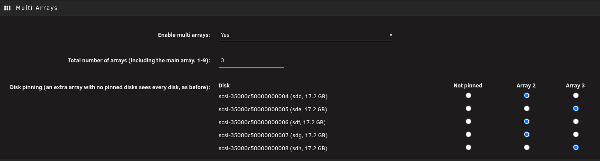
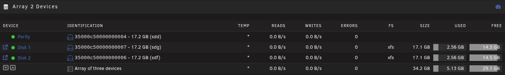
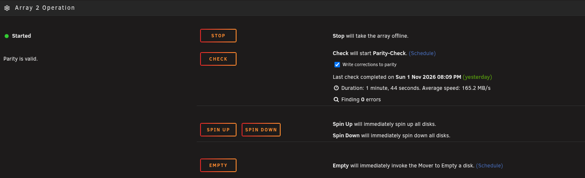

# unraid-multiarray: more than one Unraid array

> [!CAUTION]
> **Disclaimer:** Multi Arrays is an independent project, not made or supported by Lime Technology. Neither its author nor Lime Technology takes any responsibility for any results caused by this plugin or its implementation. It is a proof of concept, meant only to show how simple support for multiple arrays could be. If that doesn't sit well with you, wait for the official support for multiple arrays in Unraid.

Run several independent parity-protected arrays on one Unraid server (default: three), each with
its own Main tab: Main, Main2, Main3.

> **Proof of concept. Do not install this on a production server.**
> It exists to show that multiple arrays are within easy reach for Unraid itself, not to replace
> built-in support. It loads its own copies of the parity driver and has only been tested in a VM.
> Use a test machine or a VM with disks you don't care about.
>
> The webGUI side of this is proposed upstream in [unraid/webgui#2813](https://github.com/unraid/webgui/pull/2813).

## It is simpler than it sounds

Each array is already a self-contained unit, so a second one only needs a second copy of the same stack:

| Piece | What the plugin does |
|---|---|
| Parity driver | Loads one more copy of Unraid's md driver per extra array, under its own name (a ~200-line rename patch) |
| Array management, user shares, mover | Unchanged. Each extra array runs Unraid's own components, each with its own config folder, state and `/mnt` |
| Main tab | Main2, Main3 … are generated at install from the stock Main page of the running Unraid version, so they look and behave the same |
| Disks | Settings › Multi Arrays: pin each disk to an array; an array only sees its pinned disks |

No Unraid file is modified. The whole plugin, export and import included, is about 1,600 lines of shell and PHP.
Arrays never need to coordinate with each other: moving data between them is an ordinary copy
between two mount points.

## Screenshots

Settings, Multi Arrays: the number of arrays and which disk belongs to which array.

Main2: the devices of array 2.

Main2: the operation panel of array 2.

## Use

1. Install: Plugins › Install Plugin, paste
   `https://raw.githubusercontent.com/luuvasara/unraid-multiarray/main/multiarray.plg`
2. Settings › Multi Arrays: enable multi arrays, set the number of arrays and pin disks to each one (Apply takes effect immediately).
   Until you enable them, the plugin does nothing at all: no drivers, no Main tabs, no background work.
3. Open Main2: assign disks and start the array, exactly as on Main.

Each extra array also has its own, standard Unraid web GUI with the normal login, on port 8081
(array 2), 8082 (array 3) and so on; links are under Settings › Multi Arrays › Debug.

Extra arrays start and stop together with the main array. Disks plugged in or removed later are
picked up automatically.

- Config: `/boot/config/plugins/multiarray/multiarray.cfg`; array N's own settings: `/boot/config/plugins/multiarray/arrayN/`
- CLI: `/usr/local/emhttp/plugins/multiarray/scripts/multiarray start|stop|status|refresh [N|all]`
- Log: `/var/log/multiarray.log`

## Export and import an array

Settings › Multi Arrays › Export and import moves a whole array to another server, or onto this one as an extra array.

- **Export** writes a small JSON file: which disk is in which slot (Unraid's disk id, serial number and size, the
  things Unraid itself checks), the partition layout, file system and encryption UUIDs, and the array's settings.
  It only reads, and it works without enabling extra arrays. It never contains keys, passphrases, passwords or files.
  It refuses an array that is not clean (a disk disabled, missing or emulated, a sync running, parity never valid),
  and an array on a VM's virtual disks, with a plain explanation of why such an array has to be copied instead.
  From a terminal: `/usr/local/emhttp/plugins/multiarray/scripts/multiarray export N file.json` (1 = the main array).
- **Import** takes that file on the target server. The target is an extra array that is stopped and has no disks
  assigned or pinned, or the main array of a fresh server. Every slot must find exactly one free disk with the same
  serial number and size. The plan is shown first and nothing changes before you confirm; the assignments go through
  Unraid's own commands, the same ones the Main page sends. Then the array can be started with "Parity is already
  valid" and checked with a read-only parity check. Import never formats a disk and never starts a parity sync.

## Status

Proof of concept (see the warning above), tested in a VM on Unraid 7.3.4 (all with three arrays running at once):
- parity sync and parity checks in parallel, 0 errors
- disk failure with emulated reads, then rebuild
- start/stop cycles of the main array
- install, upgrade and removal

Not yet:
- share export (SMB/NFS) and scheduled jobs for extra arrays
- per-disk pages and parity history on MainN
- a driver build is needed per Unraid kernel version

## Development

- `src/`: package root (extracted to `/`)
- `build.sh`: builds `packages/multiarray-<version>-x86_64-1.txz` with `kit/bin/build.sh`, writes its MD5 into `multiarray.plg` and `CHANGELOG.md` from the `.plg`'s `<CHANGES>` (bump the version in the `.plg` on every change)
- `tests/run-tests.sh`: lint, the `.plg` and package checks and the export/import unit tests (`tests/xport-test.php`); `tests/render-test.sh` renders the About tab in headless Chrome
- `kit/`: the shared plugin kit (build, lint, About tab)
- `driver/md_unraid2.patch`: the change to Unraid's md driver that lets a numbered copy run next to the original
- `build/build-ko.sh KERNEL_TREE MD_SOURCE_DIR N...`: build the driver copies `ko/<kernel>/md_unraidN.ko` for a kernel
- `ko/`: prebuilt drivers, currently for 6.18.58-Unraid (Unraid 7.3.4); the plugin downloads the ones matching the running kernel

## License

GPL-2.0, see LICENSE.

## Disclaimer

Multi Arrays is an independent project, not made or supported by Lime Technology. Neither its author nor Lime Technology takes any responsibility for any results caused by this plugin or its implementation. It is a proof of concept, meant only to show how simple support for multiple arrays could be. If that doesn't sit well with you, wait for the official support for multiple arrays in Unraid.
